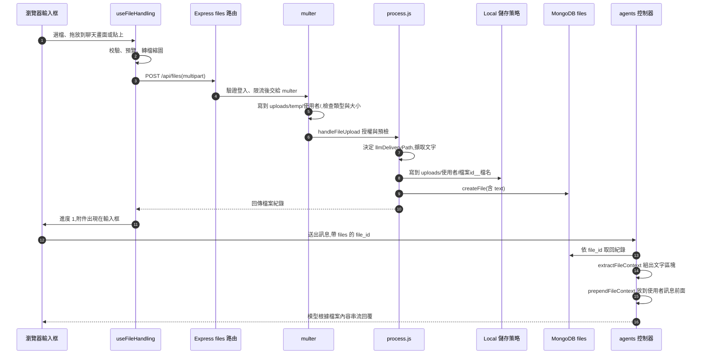

# 檔案上傳的實作

這份文件跟著一次真實的上傳,從你按下附加檔案,一路追到模型讀到檔案內容,講每一層的程式碼做了什麼。功能與用法見[檔案與圖片](files.md);使用者層的處理管線與支援的檔案,見[以文字上傳(官方文件翻譯)](../official/features/upload_as_text.md)。

追的例子是一個文字檔 `project-notes.txt`(內容是專案代號與日期),附加後問「代號是什麼」,Ollama 回答讀到的內容。文中的回應、紀錄與日誌都是實測的結果。

## 全程一覽



## 1. 前端:三個入口,一個出口

附加檔案有三種入口,最後都進同一個 hook `useFileHandling` 的 `handleFiles`:

| 入口 | 程式碼 | 說明 |
|---|---|---|
| 附件選單 | `components/Chat/Input/Files/AttachFileMenu.tsx` | 藏著一個 `<input type="file">`,按選單項目時依端點設定它的 `accept`(例如只收圖片或 PDF),再觸發點擊。選了檔案,`onChange` 呼叫 `handleFileChange` |
| 拖放 | `components/Chat/Presentation.tsx` → `components/Chat/Input/Files/DragDropWrapper.tsx` → `hooks/Files/useDragHelpers.ts` | 放置區是**整個聊天畫面**,不只是輸入框:`Presentation.tsx` 用 `DragDropWrapper` 包住整個對話區,它把 `useDragHelpers` 回傳的 `drop` 接到外層 `<div>`。`useDragHelpers` 用 `react-dnd` 的 `useDrop`,`accept: [NativeTypes.FILE]` 接收原生檔案,`handleDrop` 依情況處理:上傳被停用或設定還沒載入就提示;Assistants 端點與預設的統一模式,都直接交給 `useFileUploadRouter`,再轉成 `handleFiles`,不會跳出選擇視窗;只有舊版選擇器模式(`legacyFileUploadUX`)且有多個目的地時,才開 `DragDropModal` 讓你選 |
| 貼上 | `hooks/Input/useTextarea.ts` 的 `handlePaste` | 剪貼簿有檔案時,改名成 `clipboard_<時間戳>_<原名>` 後上傳;貼的是文字且超過 2,500 字元時,`resolvePastedTextFile` 把它轉成 `pasted-text.txt`(常數在 `utils/files.ts`),不讓大段文字留在輸入框 |

`components/Chat/Input/Files/FileUpload.tsx` 雖然名字叫 FileUpload,但它是「匯入 JSON」用的元件(例如匯入預設設定),不是附件上傳。

## 2. `useFileHandling`:校驗、預覽、進度

`hooks/Files/useFileHandling.ts`(約 900 行)是前端上傳的核心。`handleFiles` 先把整批檔案排進一個共用的佇列(同一個 `fileSetter` 的所有入口共用一條),避免兩批上傳互相搶著驗證,再呼叫 `processFiles`:

1. **取得這個端點的檔案規則**:`getEndpointFileConfig` 依 `/api/files/config`(後端的 `fileConfig`)取出目前端點允許的類型、單檔大小、數量與總大小。
2. **校驗**:先剔除重複的檔案,再檢查類型。多檔上傳時,重複或超過單檔大小的檔案會被略過並在提示裡列出名稱,其餘照常上傳;數量與總大小則是整批一起檢查,超過就整批拒絕。
3. **預處理**:每個檔案先用 `URL.createObjectURL` 建立預覽,立刻加進輸入框上方的暫存清單(進度 0.1)。HEIC 圖片轉成可用格式;圖片太大時在瀏覽器端先縮小(`useClientResize`)。
4. **上傳**:圖片等瀏覽器解碼完並量好寬高(進度 0.6)才開始上傳,其他檔案直接開始。

進度值是一個 0 到 1 的數字,用來決定附件上的轉圈與送出鈕:**進度沒到 1,送出鈕保持停用**。上傳成功才會升到 0.9,再過 300 毫秒補上伺服器回傳的欄位,升到 1。

### 送出的表單

`startUpload` 組出 `FormData`:

| 欄位 | 內容 |
|---|---|
| `endpoint`、`endpointType` | 目前對話的端點(例子裡是 `ollama` 與 `custom`) |
| `file` | 檔案本體,**檔名經過 `encodeURIComponent`**,後端會解回來 |
| `file_id` | 前端自己產生的 `uuid`,之後所有前端狀態都以它為鍵 |
| `message_file` | `true`:這是訊息的附件,不是 Agent 的檔案 |
| `conversationId` | 目前不是新對話時帶上 |
| `isTemporary` | 暫時性對話時帶上 |
| `width`、`height` | 圖片才有 |
| `tool_resource`、`agent_id` | 指定工具或 Agent 時才有 |

### 打哪個 API

`data-provider/Files/mutations.ts` 的 `useUploadFileMutation` 決定路由:有 `width` 與 `height` 的走 `dataService.uploadImage`,打 `POST /api/files/images`;其他走 `uploadFile`,打 `POST /api/files`。兩者都是 `multipart/form-data`。伺服器啟用 `fileUploadSseEnabled` 時,改用事件串流接收處理進度。

上傳成功的 `onSuccess` 會把回傳的紀錄放進 React Query 的 `files` 快取。**這就是側邊欄「附加檔案」面板馬上多出一筆的原因**:面板讀的是同一份快取。

## 3. 後端接收:中介層與 multer

`api/server/routes/files/index.js` 依序掛上:

| 順序 | 中介層 | 做什麼 |
|---|---|---|
| 1 | `requireJwtAuth` | 要求登入 |
| 2 | `configMiddleware` | 載入這個請求適用的設定(`req.config`) |
| 3 | `checkBan`、`uaParser` | 檢查封鎖,解析 User-Agent |
| 4 | 限流 | 所有 POST(語音與 `/usage` 除外)先過依 IP、再過依使用者的上傳限流 |
| 5 | `upload.single('file')` | **multer**,收下 `file` 欄位 |
| 6 | `restoreTenantContextFromReq` | 還原多租戶的上下文 |
| 7 | `files` 路由的 `handleFileUpload` | 真正的處理 |

### multer 做的事

`routes/files/multer.js`:

- **先寫到暫存區**:`diskStorage` 把檔案寫到 `uploads/temp/<使用者 id>/<檔名>`,同時產生這次上傳的伺服器端 `file_id`(`crypto.randomUUID()`,放在 `req.file_id`)。檔名先 `decodeURIComponent`(解回前端編碼的名稱),再經 `sanitizeFilename` 清理。
- **檢查類型**:`fileFilter` 依檔名推斷 MIME 類型,拿去比對這個端點允許的類型。不符就回 **HTTP 415**。
- **檢查大小**:`limits.fileSize` 是設定裡的 `serverFileSizeLimit`。

實測上傳一個 `tool.exe`(`application/x-msdownload`):

```
HTTP 415  {"message":"Unsupported file type: application/x-msdownload"}
```

這一步還沒碰到任何業務邏輯,檔案在這裡就被擋掉了。

## 4. `handleFileUpload`:授權與預檢

通過 multer 之後,`routes/files/files.js` 的 `handleFileUpload` 依序做:

1. 清理檔名。
2. `verifyAgentUploadPermission`:上傳到某個 Agent 時,先確認有權限。
3. `resolveUploadEndpoint`:Agent 的上傳以 Agent 自己的供應商為準,算出「有效端點」。
4. `resolveEffectiveToolResource`:算出這個檔案最後會歸到哪個工具資源(下一節的結果會影響它)。
5. `checkToolResourceUploadPermission`:依角色權限,檢查能不能上傳到這個工具資源。
6. `assertUploadContentAllowed`:套用內容過濾規則,在讀取內容之前先擋掉不允許的檔案。
7. **交換兩個 id**:`metadata.temp_file_id = metadata.file_id`(前端產生的),`metadata.file_id = req.file_id`(伺服器產生的)。之後資料庫與磁碟只用伺服器的 id,前端的 id 以 `temp_file_id` 回傳,讓前端對得上。
8. 呼叫 `processAgentFileUpload`(Assistants 端點走 `processFileUpload`)。
9. **收尾**:不論成功或失敗,最後都 `unlink` 刪掉暫存區的那個檔案。

## 5. 分流:檔案怎麼到達模型(`llmDeliveryPath`)

`services/Files/process.js` 的 `processAgentFileUpload` 一開始呼叫 `resolveUploadLLMDeliveryPath`(在 `packages/data-provider/src/resolve-llm-delivery-path.ts`),為檔案決定一個「送達路徑」:

| 值 | 意思 |
|---|---|
| `provider` | 檔案本身交給供應商原生處理(例如圖片走視覺) |
| `text` | 擷取成文字,把文字放進對話上下文 |
| `none` | 只存起來,不送給模型,留給 File Search、程式碼環境等工具用 |

決定的順序(找到就停):

1. 指定了工具資源:`context` 或 `ocr` 一律 `text`;`file_search` 與 `execute_code` 一律 `none`。
2. 沒指定,就走預設解析鏈:**端點的覆寫 → 端點的後備 → 全域的覆寫 → 全域的後備 → 系統預設**。覆寫可以用完整 MIME 類型或萬用字元(例如 `image/*`)比對。
3. 只有「系統預設」會再做能力檢查:已知的供應商若不能處理這種類型,就從 `provider` 降級成 `text`(能擷取文字時)或 `none`(不能擷取時,例如影片),避免上傳成功卻讓模型什麼都收不到。
4. 系統預設是 `text` 但這種類型根本擷取不出文字(壓縮檔、二進位),也降成 `none`。

我們的端點是自訂的 Ollama,實測結果:

| 上傳 | `llmDeliveryPath` |
|---|---|
| `text/plain` 文字檔 | `text` |
| `image/png` 圖片 | `provider` |

接著 `resolveUploadDestination` 把 `text` 路徑「升級」成工具資源 `context`:使用者沒選任何目的地,但路由決定要擷取文字,所以內部當成一個文字上下文來處理,走下一節的流程。

## 6. 擷取文字

工具資源是 `context` 時,走 `processAgentFileUpload` 裡的 `createTextFile` 分支。先由 `getUploadExtractedTextPlan` 依檔案類型與設定決定怎麼擷取:

| 計畫 | 條件 | 方法 |
|---|---|---|
| `configured_ocr` | 有設定 OCR,而且檔案類型在 OCR 的名單裡 | 設定的 OCR 策略;失敗時退回內建的文件解析器 |
| `configured_rag` | 有設定 RAG API,而且管理員把 `fileConfig.text` 的名單明確縮小過,檔案類型在名單裡 | 呼叫 RAG 的文字擷取;失敗時退回內建的文件解析器 |
| `document_parser` | 檔案類型是內建文件解析器處理的文件(例如 PDF、Word) | 內建的文件解析器 |
| (沒有計畫) | 其他 | 音訊走語音轉文字(STT);在 `fileConfig.text` 名單裡的類型走 `parseText`,「本來就是文字」的類型直接讀成字串 |

我們的 `.txt` 屬於最後一種,直接讀成字串。擷取出來的文字還要通過:

- 內容過濾規則(有設定時);
- 儲存大小上限(超過會報錯,請使用者縮短文件)。

這個文字會**存在資料庫的檔案紀錄裡**(`text` 欄位),不是每次送訊息時才重新讀檔。

## 7. 儲存

文字擷取完,檔案本體交給儲存策略。`getFileStrategy(appConfig, { isImage })` 依設定回傳策略名稱,預設是 `local`;`services/Files/strategies.js` 把名稱對應到一組函式(上傳、取得串流、刪除),Local、Azure、Firebase、S3 等策略有同一組介面,換儲存位置不必改上層。

`Local/crud.js` 的 `uploadLocalFile`:

1. 讀取暫存區的檔案。
2. 寫到 `uploads/<使用者 id>/<檔案 id>__<檔名>`。
3. 回傳 `filepath`(URL 形式的路徑,例如 `/uploads/<使用者 id>/...`)、`bytes`,圖片再多量出寬高。

**圖片走另一個資料夾**:`basePath` 依檔名判斷,圖片是 `images`,其他是 `uploads`。圖片還會經過 `processImageFile` 轉檔與縮放,存在 `client/public/images/<使用者 id>/`(這個路徑已被 `.gitignore` 排除)。

## 8. 建立紀錄與回應

最後 `db.createFile(fileInfo, true)` 在 MongoDB 的 `files` 集合建立一筆紀錄,`sendUploadSuccess` 把它回傳。

文字檔的回應(實測):

```json
{
  "message": "Agent file uploaded and processed successfully",
  "file_id": "7021016b-1a8e-4616-a148-f1cde29f04d2",
  "temp_file_id": "aaaaaaaa-aaaa-4aaa-8aaa-aaaaaaaaaaaa",
  "filename": "project-notes.txt",
  "type": "text/plain",
  "bytes": 43,
  "context": "message_attachment",
  "source": "local",
  "llmDeliveryPath": "text",
  "filepath": "/uploads/<使用者 id>/7021016b-...__project-notes.txt",
  "text": "Code name: Pineapple-42\nLaunch: 2026-11-15\n",
  "metadata": { "destinationChosen": false }
}
```

圖片的回應(實測,一張 1×1 的 PNG,節錄):

```json
{
  "message": "File uploaded and processed successfully",
  "filename": "dot.png",
  "type": "image/png",
  "context": "message_attachment",
  "llmDeliveryPath": "provider",
  "filepath": "/images/<使用者 id>/5efb395b-...__dot.png",
  "width": 1,
  "height": 1
}
```

| 欄位 | 意思 |
|---|---|
| `file_id`、`temp_file_id` | 伺服器的 id、前端產生的 id(第 4 節的交換) |
| `context` | `message_attachment`:這是訊息的附件(Agent 的檔案是 `agents`) |
| `llmDeliveryPath` | 第 5 節的結果 |
| `text` | 第 6 節擷取的文字,只有走文字路徑的檔案才有 |
| `source` | 儲存策略,`local` |
| `metadata.destinationChosen` | `false`:目的地是系統推斷的,不是使用者用舊版選擇器選的 |
| `expiredAt` | 資料保留生效時才會有,給[過期清理](files.md#過期清理)用 |

兩次實測後的磁碟狀態:文字檔在 `uploads/<使用者 id>/`,圖片在 `client/public/images/<使用者 id>/`,暫存區 `uploads/temp/<使用者 id>/` 是空的(收尾步驟刪掉了暫存檔)。

## 9. 前端收到回應

回到 `useUploadFileMutation` 與 `useFileHandling` 的 `onSuccess`:

1. 以前端產生的 id 為鍵,先把進度更新到 0.9、填入 `filepath`。
2. 300 毫秒後把進度升到 1,並填入伺服器回傳的 `file_id`、`type`、`filename`、`source`、`llmDeliveryPath` 等欄位。**鍵不變**(仍是前端的 id),`file_id` 才換成伺服器的:移除附件時要靠這兩個 id 找到對應的項目。
3. 這時輸入框上方的附件不再轉圈,送出鈕恢復可用。

上傳失敗時走 `onError`:刪掉那個暫存項目,顯示後端回傳的 `message`(例如上面的「Unsupported file type」),若是被使用者取消則顯示取消提示。

## 10. 送出訊息:檔案內容怎麼進到模型的輸入

附加不等於模型已經讀到,**內容是送出訊息時才放進輸入的**:

1. **前端**:`useChatFunctions` 送出時,把輸入框裡的檔案(`file_id`、`filepath`、`filename`、`type`、`llmDeliveryPath`、`height`、`width`)放進這則訊息的 `files`,然後清空輸入框的暫存清單。送出的只有 id 與中繼資料,**不含檔案內容**。
2. **後端取回紀錄**:`controllers/agents/request.js` 讀 `req.body.files`,`initializeAgent` 依 `file_id` 從 MongoDB 取回完整紀錄,包含第 6 節存起來的 `text`。
3. **組出文字區塊**:`BaseClient.addFileContextToMessage` 先挑出 `llmDeliveryPath` 是 `text` 的附件,交給 `packages/api/src/files/context.ts` 的 `extractFileContext`。它:
   - 讀取 `fileTokenLimit`(預設 100,000 tokens),文字超過就從結尾截斷;
   - 把每個檔案組成下面的格式,結果存成 `message.fileContext`:

   ````text
   Attached document(s):
   ```md
   # "project-notes.txt"
   Code name: Pineapple-42
   Launch: 2026-11-15
   ```
   ````

4. **放到訊息前面**:`controllers/agents/client.js` 組給模型的訊息時,對有 `fileContext` 的訊息呼叫 `prependFileContext`,把上面的區塊接在使用者訊息文字**前面**。這只是組給模型的那一份,資料庫裡存的訊息文字仍是使用者打的原文。
5. **歷史訊息**:程式註解寫明「歷史的附件會重新放進對話」,所以後續的每一輪對話,這則訊息前面都還帶著檔案內容,模型始終看得到。

走 `provider` 路徑的檔案(像圖片)不會被擷取成文字,而是在準備請求的階段,由編碼函式(例如 `encodeAndFormat`)依供應商的格式放進訊息內容,交給供應商處理。這條路徑要模型支援才有意義;我們預設的模型 `qwen2.5:7b` 不是視覺模型。

## 11. 刪除、預覽與下載

| 動作 | 路由 | 說明 |
|---|---|---|
| 刪除 | `DELETE /api/files` | 同時刪儲存的檔案與資料庫紀錄(前端的「我的檔案」視窗與側邊欄用它) |
| 預覽 | `GET /api/files/:file_id/preview` | 檢查檔案屬於請求者後回傳 |
| 下載 | `GET /api/files/download/:userId/:file_id` | 以 `getDownloadStream` 串流給瀏覽器 |
| 過期清理 | 後端啟動時與定期 | 見[檔案與圖片](files.md#過期清理) |

## 想自己追一遍,建議的閱讀順序

| 順序 | 檔案 | 看什麼 |
|---|---|---|
| 1 | `client/src/components/Chat/Input/Files/AttachFileMenu.tsx` | 入口怎麼設定 `accept`、怎麼接上 `handleFileChange` |
| 2 | `client/src/hooks/Files/useFileHandling.ts` | `processFiles`(校驗與預處理)、`startUpload`(組表單)、`onSuccess` |
| 3 | `client/src/data-provider/Files/mutations.ts` | 打哪個 API、成功後更新哪個快取 |
| 4 | `api/server/routes/files/index.js`、`multer.js` | 中介層順序、暫存與類型檢查 |
| 5 | `api/server/routes/files/files.js` 的 `handleFileUpload` | 授權、預檢、兩個 id 的交換 |
| 6 | `packages/data-provider/src/resolve-llm-delivery-path.ts` | 送達路徑的解析鏈 |
| 7 | `api/server/services/Files/process.js` 的 `processAgentFileUpload` | 文字擷取、儲存、建立紀錄 |
| 8 | `api/server/services/Files/Local/crud.js` | 本機儲存實際怎麼寫檔 |
| 9 | `packages/api/src/files/context.ts` | `extractFileContext` 組出文字區塊 |
| 10 | `api/app/clients/BaseClient.js` 的 `addFileContextToMessage`、`api/server/controllers/agents/client.js` | 文字區塊怎麼接到使用者訊息前面 |

## References

- [檔案與圖片](files.md):功能概覽、API、過期清理、驗證結果
- [Upload Files as Text(官方文件翻譯)](../official/features/upload_as_text.md):使用者層的處理管線
- [Upload Files as Text(官方文件)](https://www.librechat.ai/docs/features/upload_as_text)
- [File Config 物件結構(官方文件)](https://www.librechat.ai/docs/configuration/librechat_yaml/object_structure/file_config)
- [client/src/hooks/Files/useFileHandling.ts(官方 repo,rc4)](https://github.com/LibreChat-AI/LibreChat/blob/v0.8.8-rc4/client/src/hooks/Files/useFileHandling.ts)
- [api/server/routes/files/multer.js(官方 repo,rc4)](https://github.com/LibreChat-AI/LibreChat/blob/v0.8.8-rc4/api/server/routes/files/multer.js)
- [api/server/routes/files/files.js(官方 repo,rc4)](https://github.com/LibreChat-AI/LibreChat/blob/v0.8.8-rc4/api/server/routes/files/files.js)
- [api/server/services/Files/process.js(官方 repo,rc4)](https://github.com/LibreChat-AI/LibreChat/blob/v0.8.8-rc4/api/server/services/Files/process.js)
- [packages/data-provider/src/resolve-llm-delivery-path.ts(官方 repo,rc4)](https://github.com/LibreChat-AI/LibreChat/blob/v0.8.8-rc4/packages/data-provider/src/resolve-llm-delivery-path.ts)
- [packages/api/src/files/context.ts(官方 repo,rc4)](https://github.com/LibreChat-AI/LibreChat/blob/v0.8.8-rc4/packages/api/src/files/context.ts)
