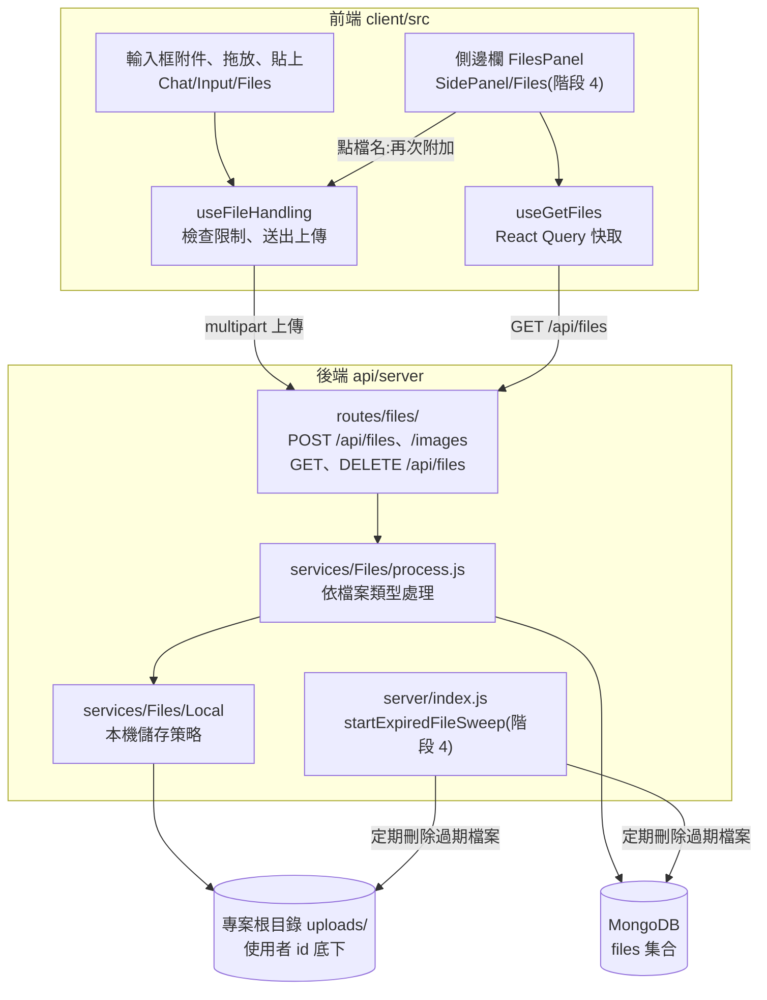

# 檔案與圖片(Files)

在對話裡附加檔案,讓模型讀到內容,並在側邊欄管理自己上傳過的檔案。這份文件說明檔案上傳怎麼走、存在哪裡、前後端怎麼接,以及階段 4 補回了什麼。

## 這個功能做什麼

| 能做的事 | 說明 |
|---|---|
| 附加檔案 | 輸入框的附件按鈕(或把檔案拖進輸入框、直接貼上)。檔案出現在輸入框上方的「暫存的上下文」,隨下一則訊息送出 |
| 以文字上傳 | 預設的上傳方式。依檔案類型與端點,LibreChat 自動擷取文字(或交給供應商原生處理),把內容放進對話上下文。純文字模型也讀得到,不需要任何設定。細節見[以文字上傳(官方文件翻譯)](../official/features/upload_as_text.md) |
| 側邊欄「附加檔案」面板 | **階段 4 補回的畫面**。表格列出你上傳過的檔案(名稱、日期),可以篩選、換頁(每頁 10 筆);點檔名,就把那個檔案再附加到目前的對話,不用重新上傳;底下的「管理檔案」按鈕開啟檔案管理視窗 |
| 重複使用 | 附加時會檢查端點的檔案限制(數量、單檔大小、總大小、類型),不符合就跳出提示 |
| 過期清理 | **階段 4 補回的後端行為**。啟動時與之後定期清理已經過期的檔案 |

## 這個階段做了什麼

檔案功能的大部分在 MVP-1 就已經在專案內:後端 `/api/files` 的所有路由、`services/Files` 的儲存策略與圖片處理、前端輸入框的附件元件。階段 4 補回的是兩個小地方:

| 補回的內容 | 檔案 |
|---|---|
| 側邊欄「附加檔案」面板(4 個新檔案) | `client/src/components/SidePanel/Files/` 的 `Panel.tsx`、`PanelColumns.tsx`、`PanelFileCell.tsx`、`PanelTable.tsx` |
| 把面板接進側邊欄(換回官方版的一段) | `client/src/hooks/Nav/useSideNavLinks.ts`:`FilesPanel` 的 `import`,以及 `id: 'files'` 的 `links.push` 區塊(9 行) |
| 啟動過期檔案清理(換回官方版的兩行) | `api/server/index.js`:`startExpiredFileSweep` 的 `require`,以及 `initializeFileStorage(appConfig)` 後面的呼叫 |

這個階段沒有設定要改。

## 歷史

| 時間 | 事件 |
|---|---|
| 2023-04 | 檔案與圖片上傳加入 |

## 怎麼運作

### API

| 方法與路徑 | 用途 |
|---|---|
| `POST /api/files` | 上傳檔案(multipart,欄位含 `file`、`endpoint`、`endpointType`、`file_id`、`message_file`) |
| `POST /api/files/images` | 上傳圖片 |
| `GET /api/files` | 列出自己的檔案 |
| `GET /api/files/config` | 取得檔案設定(`fileConfig`),前端用它檢查限制 |
| `DELETE /api/files` | 刪除檔案 |
| `GET /api/files/:file_id/preview` | 預覽 |
| `GET /api/files/download/:userId/:file_id` | 下載 |

這些路由都要登入,並會檢查檔案是否屬於請求者。

### 一次上傳的紀錄

在暫存區用 API 上傳一個文字檔 `notes.txt`(作為訊息附件),回傳的紀錄包含:

| 欄位 | 值 |
|---|---|
| `context` | `message_attachment`(這是訊息的附件) |
| `llmDeliveryPath` | `text`(內容以擷取出的文字送給模型) |
| `filepath` | `/uploads/<使用者 id>/<檔案 id>__notes.txt` |
| `bytes` | `45` |

檔案實際存在專案根目錄的 `uploads/<使用者 id>/` 底下,資料庫的 `files` 集合存紀錄。圖片則存在 `client/public/images/<使用者 id>/`。兩個資料夾都已被 `.gitignore` 排除,不會進版控。每一步的細節見[檔案上傳的實作](file-upload.md)。

### 過期清理

`startExpiredFileSweep` 在後端啟動時立刻跑一次,之後依固定間隔重複:找出已過期的檔案(一次最多 100 筆),交給檔案刪除流程刪除(同時移除儲存的檔案與資料庫紀錄)。間隔由環境變數 `FILE_RETENTION_SWEEP_INTERVAL_MS` 控制,設成 `0` 就停用。在多節點部署裡,只有被選為主節點的那一台會執行。

檔案有沒有過期時間,取決於資料保留的設定;沒有過期時間的檔案不會被清理。

## 驗證結果

先在暫存區建置並用 API 驗證(上傳、列出),再把檔案帶進專案,在瀏覽器完整操作一遍。

| 項目 | 結果 |
|---|---|
| 專案建置 | `npm run frontend` 通過(結束碼 0,無錯誤) |
| 側邊欄 | 在提示詞與參數之間多了迴紋針圖示。面板有篩選欄「篩選檔案...」、「名稱」與「日期」兩欄的表格、「管理檔案」按鈕、分頁(上一個、下一個)。沒有檔案時顯示「沒有結果。」 |
| 附加檔案 | 用輸入框的檔案欄位附加 `project-notes.txt`(160 位元組的文字檔)。檔案出現在輸入框上方,標示「Document」;同時側邊欄面板列出它,頁數 1/1 |
| 模型讀得到內容 | 送出 `What is the code name and the launch date in the attached file?`,Ollama(`qwen2.5:7b`)串流回答 `The code name of the project is Pineapple-42, and the launch date is 2026-11-15.`,和檔案內容一致。對話自動命名為「Code Name and Launch Date」,送出的訊息上顯示附件 |
| 資料庫與磁碟 | `files` 集合一筆:`source: local`、`context: message_attachment`、`llmDeliveryPath: text`、`bytes: 160`、`filepath: /uploads/<使用者 id>/<檔案 id>__project-notes.txt`;磁碟上 `uploads/<使用者 id>/` 底下有同名檔案 |
| 面板點檔名 | 開新對話,點面板裡的 `project-notes.txt`,檔案立刻再次附加到輸入框,沒有重新上傳 |
| 管理檔案視窗 | 按「管理檔案」開啟「我的檔案」視窗:欄位有名稱、日期、儲存空間(主機)、前後文(附件)、大小(`< 0.01 MB`),上方有「刪除」按鈕、篩選欄與篩選選單,底下顯示「已選取 0 個檔案,共 1 個檔案」與分頁 |
| 刪除 | 勾選檔案、按「刪除」,提示「已成功刪除」,列表變成「沒有結果。」;資料庫 0 筆、磁碟 0 個檔案,輸入框上的附件也消失 |
| 過期清理 | 再上傳一次,檔案一開始沒有 `expiredAt`;把它的 `expiredAt` 改成一小時前,重啟後端。啟動日誌出現 `[sweepExpiredFiles] Processed 1 expired files: 1 deleted, 0 failed`,資料庫與磁碟都清空 |

## 補充

- **啟動警告是正常的**:日誌會出現 `RAG API is either not running or not reachable ... you may experience errors with file uploads.`。RAG API 是另一個選用服務(用向量搜尋大量文件,見官方 [RAG API](https://www.librechat.ai/docs/features/rag_api)),「以文字上傳」不需要它,上傳文字檔照常成功。
- **圖片**:官方說明圖片要得到文字需要 OCR,否則要搭配視覺模型。我們的預設模型 `qwen2.5:7b` 不是視覺模型。
- 附加檔案時,「以文字上傳」之外的 File Search、Code 等目的地屬於後面的階段(Agents、程式碼環境)。

## References

- [檔案上傳的實作](file-upload.md):一次上傳從前端到模型輸入的完整技術路徑
- [Upload Files as Text(官方文件翻譯)](../official/features/upload_as_text.md)
- [Message Composer(官方文件翻譯)](../official/features/composer.md):`+` 面板與加入檔案
- [Upload Files as Text(官方文件)](https://www.librechat.ai/docs/features/upload_as_text)
- [File Config 物件結構(官方文件)](https://www.librechat.ai/docs/configuration/librechat_yaml/object_structure/file_config)
- [api/server/routes/files/files.js(官方 repo,rc4)](https://github.com/LibreChat-AI/LibreChat/blob/v0.8.8-rc4/api/server/routes/files/files.js)
- [packages/api/src/files/sweep.ts(官方 repo,rc4)](https://github.com/LibreChat-AI/LibreChat/blob/v0.8.8-rc4/packages/api/src/files/sweep.ts)
- [client/src/components/SidePanel/Files(官方 repo,rc4)](https://github.com/LibreChat-AI/LibreChat/tree/v0.8.8-rc4/client/src/components/SidePanel/Files)
- [提示詞](prompts.md)、[搜尋](search.md)、[預設設定](presets.md):前面的階段
- [路線圖](../roadmap.md):階段 4
