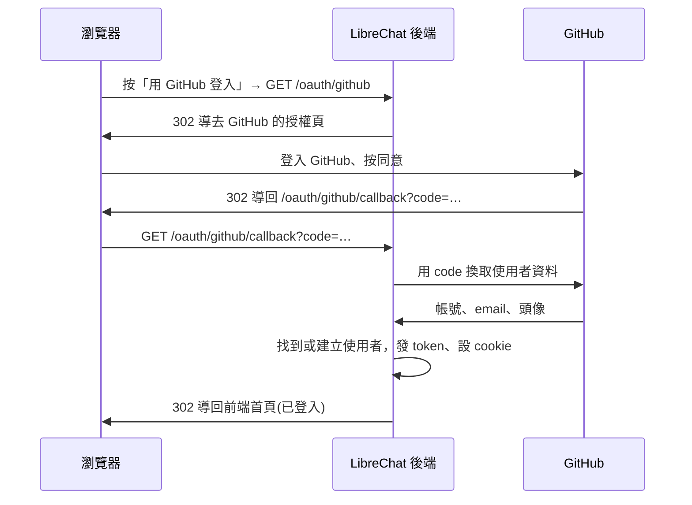

# OAuth 與 OpenID

讓使用者用 GitHub、Google 等外部帳號登入 LibreChat,不用另設密碼。這份文件說明它怎麼走、涉及哪些檔案，以及階段 5 做了什麼。

## 這個功能做什麼

登入頁除了 email 和密碼，可以多出「用 GitHub 登入」「用 Google 登入」這類按鈕。按下去會跳到那個服務的登入頁，使用者同意後再跳回 LibreChat,這時已經登入完成。

支援的登入方式:

| 種類 | 提供者 |
|---|---|
| OAuth 2.0 社群登入 | Google、Facebook、GitHub、Discord、Apple |
| OpenID Connect | 任何符合標準的身分提供者(例如 Keycloak、Authentik、Auth0、Azure Entra ID) |
| SAML | 企業常用的 SAML 身分提供者 |

這三種的路由都在 `/oauth` 底下，所以放在同一個階段。

## 這個階段做了什麼

**補回程式碼，但維持關閉。** 補完後，我們的專案和官方 rc4、本機的 `LibreChat-sep` 一樣:程式碼都在，但沒有設定任何提供者，所以登入頁看起來和原本相同。

| 檔案 | 動作 |
|---|---|
| `api/server/routes/oauth.js` | 新增(官方原檔) |
| `api/server/controllers/auth/oauth.js` | 新增(官方原檔) |
| `api/server/routes/index.js` | 補回 `oauth` 的 `require` 與匯出 |
| `api/server/index.js` | 補回 `app.use('/oauth', preAuthTenantMiddleware, routes.oauth)` |

各提供者的登入策略(`api/strategies/` 的 `githubStrategy.js`、`openidStrategy.js` 等)、負責登記策略的 `api/server/socialLogins.js`,以及前端登入頁的按鈕元件，在 MVP-1 就已經在專案內。缺的只是讓瀏覽器走得進來的 `/oauth` 路由。

`api/server/index.js` 裡另有 `initializeOAuthReconnectManager`,名稱有 OAuth,但它負責 MCP 伺服器的 OAuth 重新連線，屬於 MCP 階段。

## 歷史

| 時間 | 事件 |
|---|---|
| 2023-05 | 帳號系統加入(`feat: Auth and User System`),同時有 `routes/oauth.js`,支援 Google、Facebook |
| 2023-06 | OpenID Connect |
| 2023-07 | GitHub、Discord |
| 2023-08 | 啟動程式重構，策略的登記搬到 `socialLogins.js` |
| 2025-01 | Apple |
| 2025-05 | SAML |
| 2026-01 | 管理面板的登入，登入成功後的處理抽出成 `controllers/auth/oauth.js` |

## 怎麼運作

以 GitHub 為例:



### 三層開關

按鈕要出現、登入要能走通，三層都要打開:

| 層 | 設定 | 影響 |
|---|---|---|
| 1. 總開關 | `.env` 的 `ALLOW_SOCIAL_LOGIN=true` | 後端啟動時才會呼叫 `configureSocialLogins`;前端登入頁才會顯示社群登入區塊 |
| 2. 各提供者的金鑰 | 例如 `GITHUB_CLIENT_ID`、`GITHUB_CLIENT_SECRET` | 兩個都有值，該提供者的策略才會登記到 passport,`/api/config` 的 `githubLoginEnabled` 才是 `true`,按鈕才會出現 |
| 3. 顯示清單(選用) | `librechat.yaml` 的 `registration.socialLogins` | 決定按鈕的順序與要顯示哪些;沒設時用預設的 `google`、`facebook`、`openid`、`github`、`discord`、`saml` |

另一個相關的開關是 `ALLOW_SOCIAL_REGISTRATION`:決定第一次用外部帳號登入時，能不能自動建立新帳號。

我們的 `.env` 沿用官方範本:`ALLOW_SOCIAL_LOGIN=false`、`ALLOW_SOCIAL_REGISTRATION=false`,各提供者的金鑰都是空的。

### 後端

`api/server/index.js` 啟動時:

```js
if (isEnabled(ALLOW_SOCIAL_LOGIN)) {
  await configureSocialLogins(app, appConfig);
}
```

`socialLogins.js` 逐一檢查各提供者的環境變數，有設定的才 `passport.use(...)` 登記策略。OpenID 和 SAML 另外需要 session(`OPENID_SESSION_SECRET`、`SAML_SESSION_SECRET`)。

`routes/oauth.js` 先掛三個中介層，再定義各提供者的路由:

| 中介層 | 做什麼 |
|---|---|
| `logHeaders` | 有反向代理的 `X-Forwarded-*` 標頭時，記到除錯日誌，方便排查登入問題 |
| `markOAuthNavigation` | 標記這個請求是瀏覽器的頁面跳轉。之後的中介層若要拒絕它，改為導回登入頁，而不是回一段 JSON(瀏覽器會把 JSON 直接顯示成頁面) |
| `loginLimiter` | 登入限流，和 email 登入共用 |

| 路由 | 做什麼 |
|---|---|
| `GET /oauth/<提供者>` | `passport.authenticate('<提供者>')`,把人導去提供者的授權頁 |
| `GET /oauth/<提供者>/callback`(Apple、SAML 是 `POST`) | 驗證提供者回傳的結果 → `setBalanceConfig`(依設定檔的 `balance` 同步這個使用者的點數餘額設定)→ `checkDomainAllowed`(檢查 email 網域是否允許)→ `oauthHandler` |
| `GET /oauth/error` | 登入失敗時記錄原因，導回 `/login?redirect=false&error=auth_failed` |

`controllers/auth/oauth.js` 的 `createOAuthHandler` 是登入成功後的最後一步：檢查封鎖、發 token、設 cookie,然後導回前端。若登入是從管理面板發起的，則改為發一次性的交換碼給管理面板。

### 前端

`client/src/components/Auth/SocialLoginRender.tsx` 讀 `/api/config`:`socialLoginEnabled` 為 `true` 才顯示社群登入區塊，每個提供者再看自己的 `<提供者>LoginEnabled`。按鈕(`SocialButton.tsx`)只是一個連結:

```tsx
href={`${serverDomain}/oauth/${oauthPath}`}
```

所以整個登入流程是瀏覽器的頁面跳轉，不是前端發出的 API 請求。

## 驗證

在暫存區(埠 3095、獨立資料庫)補回後，和本機的 `LibreChat-sep`(官方 rc4,埠 3081)發出同樣的請求比對:

| 請求 | 暫存區 | `LibreChat-sep` |
|---|---|---|
| `GET /oauth/error` | 302 → `/login?redirect=false&error=auth_failed` | 相同 |
| `GET /oauth/github`、`/google`、`/openid`、`/github/callback` | 500 | 相同 |
| `/api/config` | `socialLoginEnabled`、`githubLoginEnabled`、`openidLoginEnabled` 為 `false`,`emailLoginEnabled` 為 `true` | 相同 |
| email 註冊、登入 | 200,取得 token | |

`/oauth/github` 回 500 的原因，在後端日誌是:

```
ErrorController => error Unknown authentication strategy "github"
```

總開關 `ALLOW_SOCIAL_LOGIN` 關著，`configureSocialLogins` 沒有執行,passport 裡沒有登記 `github` 策略。正常使用時不會走到這裡，因為按鈕不會出現。

補回之前，專案沒有 `/oauth` 路由,`/oauth/error`、`/oauth/github` 會落到後端最後的「前端頁面」處理，回 200 和前端的 `index.html`。

## 要真的開啟時

以 GitHub 為例(官方設定頁見下方 References):

1. 在 GitHub 的 Developer settings 建立 OAuth App,callback URL 填 `http://localhost:3090/oauth/github/callback`。
2. `.env` 設定 `ALLOW_SOCIAL_LOGIN=true`、`GITHUB_CLIENT_ID`、`GITHUB_CLIENT_SECRET`;要讓新使用者能用 GitHub 註冊，再設 `ALLOW_SOCIAL_REGISTRATION=true`。
3. 重新啟動後端，登入頁就會出現 GitHub 按鈕。

## References

- [Authentication(官方文件)](https://www.librechat.ai/docs/configuration/authentication):登入方式總覽與 `ALLOW_SOCIAL_LOGIN` 等環境變數
- [OAuth2 / OIDC(官方文件)](https://www.librechat.ai/docs/configuration/authentication/OAuth2-OIDC):各提供者的設定頁(GitHub、Google、Keycloak、Authentik 等)
- [GitHub 登入設定(官方文件)](https://www.librechat.ai/docs/configuration/authentication/OAuth2-OIDC/github)
- [api/server/routes/oauth.js(官方 repo,rc4)](https://github.com/LibreChat-AI/LibreChat/blob/v0.8.8-rc4/api/server/routes/oauth.js)
- [api/server/controllers/auth/oauth.js(官方 repo,rc4)](https://github.com/LibreChat-AI/LibreChat/blob/v0.8.8-rc4/api/server/controllers/auth/oauth.js)
- [api/server/socialLogins.js(官方 repo,rc4)](https://github.com/LibreChat-AI/LibreChat/blob/v0.8.8-rc4/api/server/socialLogins.js)
- [client/src/components/Auth/SocialLoginRender.tsx(官方 repo,rc4)](https://github.com/LibreChat-AI/LibreChat/blob/v0.8.8-rc4/client/src/components/Auth/SocialLoginRender.tsx)
- [檔案與圖片](files.md):前一個階段
- [路線圖](../roadmap.md):階段 5
