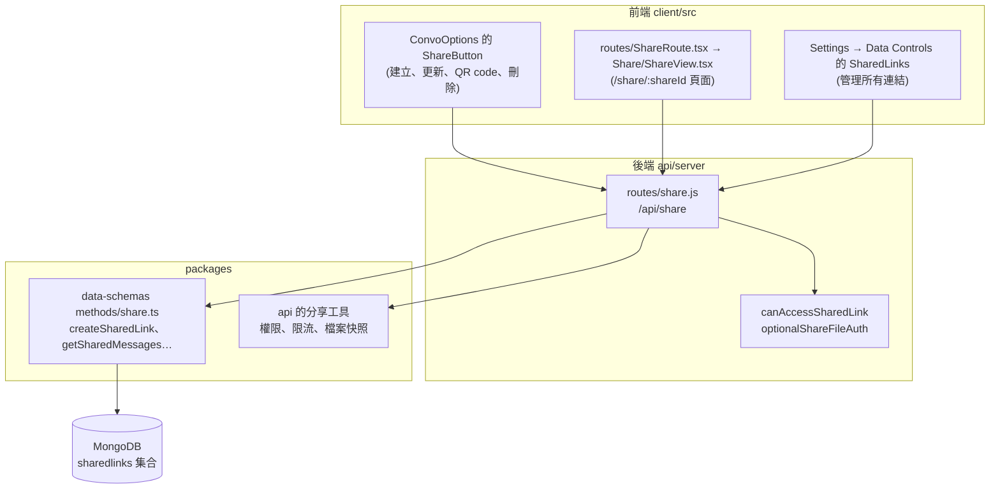

# 分享(Shared Links)

把一段對話發布成唯讀的連結，讓別人打開來看。功能本身的說明見官方頁面的翻譯[分享連結](../official/features/shareable_links.md);這份文件補充程式碼怎麼對應，以及階段 7 做了什麼。

## 這個階段做了什麼

前端的分享畫面在 MVP-1 就保留了(聊天畫面直接用到，刪不掉)，缺的是後端的 `/api/share`。所以在 MVP-1 按「分享」不會成功，打開分享網址也讀不到內容。階段 7 補回後端:

| 檔案 | 動作 |
|---|---|
| `api/server/routes/share.js` | 新增(官方原檔，所有分享 API) |
| `api/server/middleware/canAccessSharedLink.js` | 新增(官方原檔，檢查能不能看這個連結) |
| `api/server/middleware/optionalShareFileAuth.js` | 新增(官方原檔，讀取分享中的檔案時選擇性檢查登入) |
| `api/server/routes/index.js` | 補回 `share` 的 `require` 與匯出 |
| `api/server/index.js` | 補回 `app.use('/api/share', preAuthTenantMiddleware, routes.share)` |

設定不用改。`.env` 沿用官方範本:`ALLOW_SHARED_LINKS=true`(可以建立)、`ALLOW_SHARED_LINKS_PUBLIC=false`(看的人要登入)。

## 歷史

| 時間 | 事件 |
|---|---|
| 2024-05 | 分享連結加入(`feat: Shared Links`),同時有 `routes/share.js`、`ShareRoute.tsx`、`ShareView.tsx` |
| 2025-03 | 資料模型搬到 `@librechat/data-schemas` |
| 2026-06 | 以權限系統(ACL)控制誰能看(`canAccessSharedLink.js`);分享時一起快照檔案(`optionalShareFileAuth.js`);可以把分享的對話接續成自己的副本 |
| 2026-08 | 對話清單的分享標記，更新內容時網址不變 |
| 2026-09 | 讀取分享連結加上限流 |

## 怎麼運作

### API

網址定義在 `packages/data-provider/src/api-endpoints.ts`(`shareRoot = /api/share`)。

| 方法與路徑 | 誰能用 | 做什麼 |
|---|---|---|
| `GET /api/share/link/:conversationId` | 擁有者 | 查這段對話有沒有分享過，回 `shareId` |
| `POST /api/share/:conversationId` | 擁有者 | 建立分享連結 |
| `PATCH /api/share/:shareId` | 擁有者 | 更新連結(發布較新的訊息，網址不變) |
| `DELETE /api/share/:shareId` | 擁有者 | 刪除連結 |
| `GET /api/share` | 登入者 | 列出自己的所有連結(分頁、搜尋、排序) |
| `GET /api/share/:shareId` | 有權限看的人 | 讀取分享的對話內容 |
| `GET /api/share/:shareId/config` | 有權限看的人 | 分享頁面用的介面設定 |
| `POST /api/share/:shareId/fork` | 登入者 | 接續成自己的副本(Continue this chat) |
| `GET /api/share/:shareId/files/:file_id`(含 `/preview`、`/download`) | 有權限看的人 | 讀取快照的檔案 |

`ALLOW_SHARED_LINKS=false` 時，讀取、fork 與檔案這幾條路由不會被註冊。

### 誰能看

`GET /api/share/:shareId` 依序經過:

| 中介層 | 做什麼 |
|---|---|
| `optionalJwtAuth` | 有登入就認出是誰，沒登入也放行 |
| `shareIpLimiter`、`shareUserLimiter` | 讀取限流 |
| `canAccessSharedLink` | 依權限決定能不能看。`ALLOW_SHARED_LINKS_PUBLIC=false` 時，沒登入回 401 |
| `sharedLinkConfigMiddleware` | 載入適用的設定 |

## 驗證

在暫存區(埠 3095、獨立資料庫)補回後，先跑 MVP 的 API 驗收 11 項，全部通過。接著用 A(擁有者)、B(另一個登入的使用者)、未登入三種身分走完分享流程:

| 步驟 | 結果 |
|---|---|
| A 查對話有沒有分享過 | 200,`success: false` |
| A 建立連結 | 200,取得 `shareId` |
| A 再查 / 列出自己的連結 | 200,查得到 / 1 筆 |
| B 打開連結 | 200,看到標題與 2 則訊息 |
| 未登入打開連結、讀分享頁設定 | 401 `Authentication required` |
| B 接續成副本(fork) | 201,B 的對話從 0 筆變 1 筆 |
| B 刪除 A 的連結 | 404,只有擁有者能刪 |
| A 刪除連結 | 200 |
| 刪除後 B 再打開 | 404 `Shared link not found` |

登入後的 `/api/config` 是 `sharedLinksEnabled: true`、`publicSharedLinksEnabled: false`。

## References

- [分享連結(官方文件翻譯)](../official/features/shareable_links.md)
- [Shareable Links(官方文件)](https://www.librechat.ai/docs/features/shareable_links)
- [api/server/routes/share.js(官方 repo,rc4)](https://github.com/LibreChat-AI/LibreChat/blob/v0.8.8-rc4/api/server/routes/share.js)
- [api/server/middleware/canAccessSharedLink.js(官方 repo,rc4)](https://github.com/LibreChat-AI/LibreChat/blob/v0.8.8-rc4/api/server/middleware/canAccessSharedLink.js)
- [api/server/middleware/optionalShareFileAuth.js(官方 repo,rc4)](https://github.com/LibreChat-AI/LibreChat/blob/v0.8.8-rc4/api/server/middleware/optionalShareFileAuth.js)
- [packages/data-schemas/src/methods/share.ts(官方 repo,rc4)](https://github.com/LibreChat-AI/LibreChat/blob/v0.8.8-rc4/packages/data-schemas/src/methods/share.ts)
- [client/src/components/Share/ShareView.tsx(官方 repo,rc4)](https://github.com/LibreChat-AI/LibreChat/blob/v0.8.8-rc4/client/src/components/Share/ShareView.tsx)
- [Redis 與快取](redis.md):前一個階段
- [路線圖](../roadmap.md):階段 7
